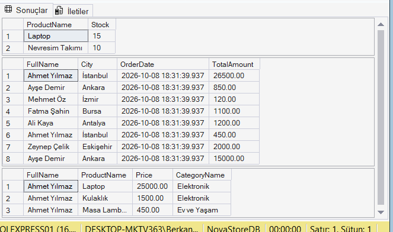
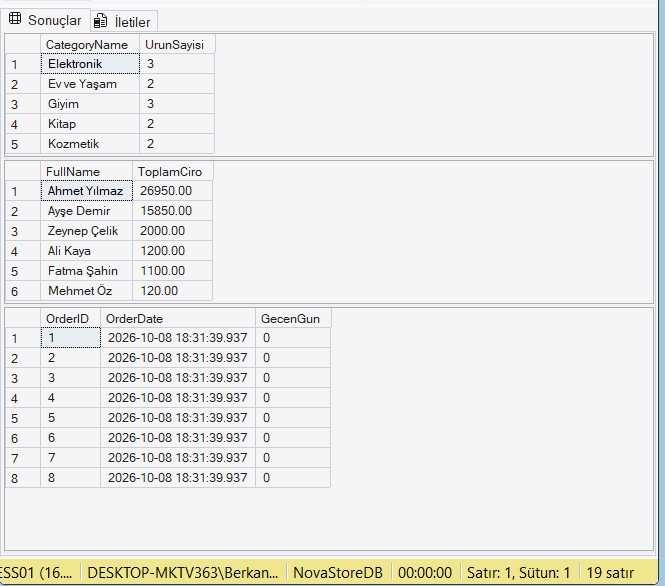
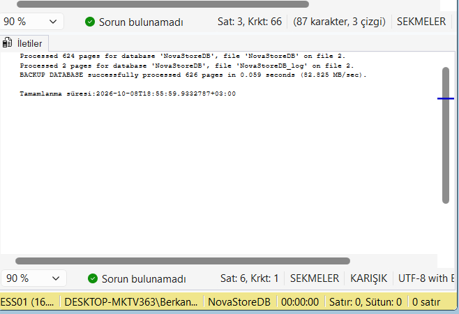

<h1 align="center">NovaStore E-Commerce SQL Database Project </h1>

  
  
  

  <a href="#-english">English</a> | <a href="#-türkçe">Türkçe</a>

---

## 🇬🇧 English
This project involves the comprehensive design and management of a relational database for a fictitious e-commerce platform named "NovaStore". 

### Key Features:
* **Database Design (DDL):** Logical architecture including primary/foreign key relationships across 5 core tables.
* **Data Manipulation (DML):** Scripted insertion of dummy data for realistic testing environments.
* **Complex Queries & Analysis (DQL):** Advanced SQL queries utilizing `INNER JOIN`, `LEFT JOIN`, `GROUP BY`, and date functions.
* **Advanced Objects:** Implementation of standard SQL `VIEW`s and `BACKUP` procedures.

** Project Files (Click to View):**
* [ AdSoyad_NovaStore_Proje.sql](./AdSoyad_NovaStore_Proje.sql): The complete, commented SQL script.
* [ AdSoyad_NovaStore_Proje.docx](./AdSoyad_NovaStore_Proje.docx): Detailed project report.

---

## 🇹🇷 Türkçe
Bu proje, "NovaStore" adlı kurgusal bir e-ticaret platformu için kapsamlı bir ilişkisel veri tabanı tasarımı ve yönetimini içermektedir.

### Temel Özellikler:
* **Veri Tabanı Tasarımı (DDL):** 5 temel tablo arasında birincil/yabancı anahtar (PK/FK) ilişkilerini barındıran mantıksal mimari.
* **Veri Manipülasyonu (DML):** Gerçekçi test ortamları için örnek verilerin script ile eklenmesi.
* **Karmaşık Sorgular ve Analiz (DQL):** İş zekası raporlamaları için `JOIN`, `GROUP BY` ve kümeleme fonksiyonları kullanan ileri düzey SQL sorguları.
* **İleri Düzey Nesneler:** Standart SQL `VIEW` ve `BACKUP` prosedürlerinin uygulanması.

** Teslim Edilen Dosyalar (Tıklayıp Görüntüleyebilirsiniz):**
* [ AdSoyad_NovaStore_Proje.sql](./AdSoyad_NovaStore_Proje.sql): Baştan sona yorum satırlı tam SQL scripti.
* [ AdSoyad_NovaStore_Proje.docx](./AdSoyad_NovaStore_Proje.docx): Proje raporu ve yönergeler.

---

##  Screenshots & Diagrams / Proje Görselleri

### 1. Entity-Relationship (ER) Diagram / İlişkisel Diyagram

### 2. Query Results & Analytics / Sorgu ve Raporlama Sonuçları

### 3. Database Backup / Veri Tabanı Yedekleme

---
*Developed by [Berkant](https://github.com/berkantkilic777-gif)*