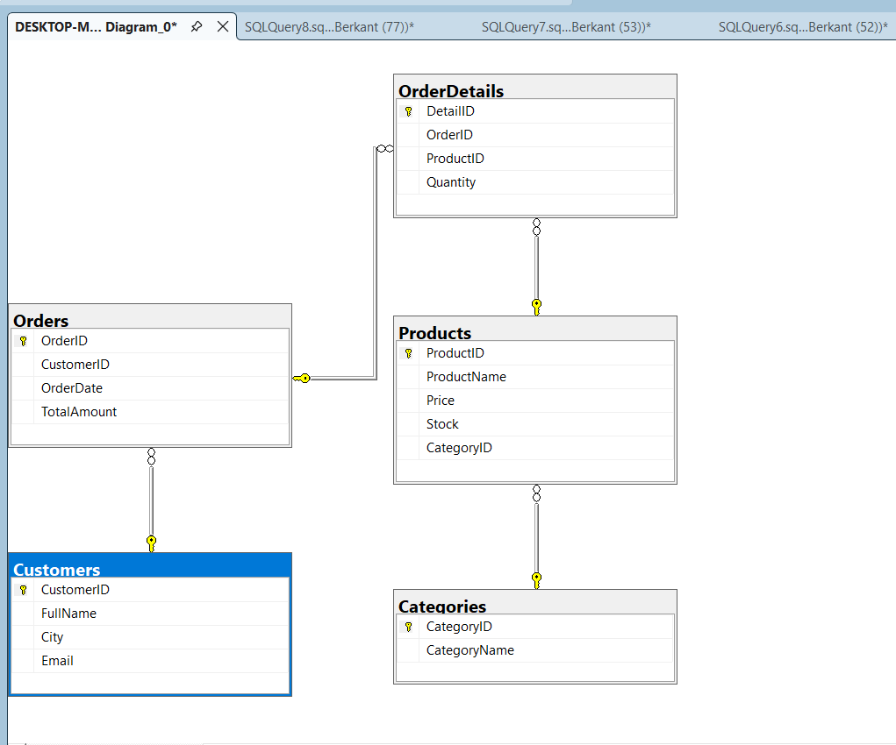
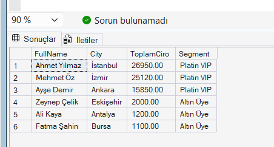

<h1 align="center">NovaStore E-Commerce SQL Database Project</h1>

  
  
  
  

  <a href="#english">English</a> | <a href="#turkce">Turkce</a>

---

## English Documentation

### Project Overview and Architecture
This project encompasses the end-to-end relational database design, data integrity enforcement, and business intelligence reporting for a mock e-commerce system named "NovaStore", developed in Microsoft SQL Server (T-SQL). Built as part of the Software Persona Database Management curriculum, it demonstrates production-grade database modeling, analytical queries, and advanced database programmability objects.

### Core & Enterprise Features:
- Database Design (DDL): Normalized 5-table relational architecture (`Categories`, `Products`, `Customers`, `Orders`, `OrderDetails`) with primary and foreign key constraints.
- Data Integrity (Constraints): Enforced business rules preventing negative prices, negative stock, and invalid order quantities via `CHECK` constraints.
- Mock Data Management (DML): Automated relational dummy datasets reflecting realistic retail purchasing behaviors.
- Business Analytics & DQL: High-performance queries utilizing `INNER JOIN`, multi-table joins, `GROUP BY`, aggregate functions (`SUM`, `COUNT`), and date diff analytics (`DATEDIFF`).
- Views & Disaster Recovery: Reporting views (`vw_SiparisOzet`) and automated native database backup procedures (`BACKUP DATABASE`).
- Performance Optimization: Non-clustered indexes on high-frequency join and foreign key columns (`CustomerID`, `CategoryID`, composite order-product keys).
- Event-Driven Automation (Triggers): Automatic inventory validation and stock deduction trigger (`trg_OrderDetails_StockUpdate`) preventing out-of-stock transactions.
- Customer Segmentation (UDF): User-defined scalar function dynamically categorizing customer lifetime value into loyalty tiers (Platin VIP, Altin Uye, Standart).
- ACID Transaction Management (Stored Procedure): Atomic order processing procedure (`sp_CreateNewOrder`) executing multi-table insertions inside safe `TRY...CATCH` transaction blocks.

### Project Files:
- [Berkant_Kilic_NovaStore_Proje.sql](./Berkant_Kilic_NovaStore_Proje.sql): Complete commented T-SQL script containing all DDL, DML, DQL, and advanced objects.
- [Berkant_Kilic_NovaStore_Proje.docx](./Berkant_Kilic_NovaStore_Proje.docx): Comprehensive project execution report with Markdown blocks and query results.
- [Berkant_Kilic_NovaStore_Proje.png](./Berkant_Kilic_NovaStore_Proje.png): High-resolution Entity-Relationship (ER) diagram.

---

## Turkce Dokumantasyon

### Proje Ozeti ve Mimari Kapsam
Bu proje, "NovaStore" adli e-ticaret platformu icin Microsoft SQL Server (T-SQL) uzerinde sifirdan insa edilmis iliskisel veri tabani mimarisini, veri guvenligi kurallarini ve is zekasi analitik raporlamalarini icermektedir. Software Persona Veri Tabani Gelistirme egitimi bitirme projesi olarak; saf CRUD tasariminin otesinde kurumsal DBA ve Backend standartlarinda gelistirilmistir.

### Temel ve Ileri Duzey Yetenekler:
- Veri Tabani Tasarimi (DDL): 5 temel tablo (`Categories`, `Products`, `Customers`, `Orders`, `OrderDetails`) uzerinde normalize edilmis Primary Key ve Foreign Key iliskileri.
- Veri Butunlugu (Constraints): Eksi fiyat, negatif stok ve sifir adetli siparis girislerini engelleyen veri tabani seviyesinde `CHECK` kisitlamalari.
- Veri Manipulasyonu (DML): Gercekci e-ticaret senaryolarini test etmek amaciyla iliskisel olarak kurgulanmis ornek veri seti.
- Raporlama ve Is Zekasi (DQL): Coklu `JOIN`, `GROUP BY`, kuveleme fonksiyonlari (`COUNT`, `SUM`) ve siparis gecmis gun hesaplamalari (`DATEDIFF`).
- Raporlama Gorunumu ve Yedekleme: Raporlama sorgularini basitlestiren `vw_SiparisOzet` gorunumu ve felaket kurtarma senaryolarina uygun `BACKUP DATABASE` yordami.
- Performans Optimizasyonu (Indexes): Yabanci anahtarlar ve sorgu filtreleri uzerinde arama maliyetini dusuren Non-Clustered indeks yapisi.
- Otomatik Stok Takip Tetikleyicisi (Trigger): Yeni siparis girildiginde urun stogunu otomatik denetleyen ve yetersiz stokta islemi geri alan `trg_OrderDetails_StockUpdate` tetikleyicisi.
- Dinamik Segmentasyon Fonksiyonu (UDF): Musterinin toplam harcamasini analiz ederek sadakat seviyesini (Platin VIP, Altin Uye, Standart) hesaplayan skalar fonksiyon.
- Guvenli Siparis Sakli Yordami (Stored Procedure): Siparis basligi ve detayini veri butunlugunu koruyarak tek bir ACID transaction icinde yuruten `sp_CreateNewOrder` yordami.

### Teslim Edilen Proje Dosyalari:
- [Berkant_Kilic_NovaStore_Proje.sql](./Berkant_Kilic_NovaStore_Proje.sql): Tum DDL, DML, DQL ve gelismis nesneleri iceren yorum satirli T-SQL betigi.
- [Berkant_Kilic_NovaStore_Proje.docx](./Berkant_Kilic_NovaStore_Proje.docx): Markdown kod kutulari, sonuclar ve aciklamalari iceren detayli proje teslim raporu.
- [Berkant_Kilic_NovaStore_Proje.png](./Berkant_Kilic_NovaStore_Proje.png): SSMS uzerinden alinmis iliskisel ER sema gorseli.

---

## Proje Gorselleri ve Raporlar / Screenshots & Analytics

### 1. Iliskisel Sema / Entity-Relationship (ER) Diagram

  

### 2. Temel Sorgular ve Coklu Iliskiler (DQL - Part 1)

  

### 3. Analitik, Gruplama ve Zaman Sorgulari (DQL - Part 2)

  

### 4. Veri Tabani Yedekleme (Disaster Recovery Backup)

  

### 5. Kurumsal Ekstralar: Stored Procedure & Trigger Dogrulama

  

---

## Gelistirici / Author

- Berkant Kilic
- GitHub: https://github.com/berkantkilic777-gif